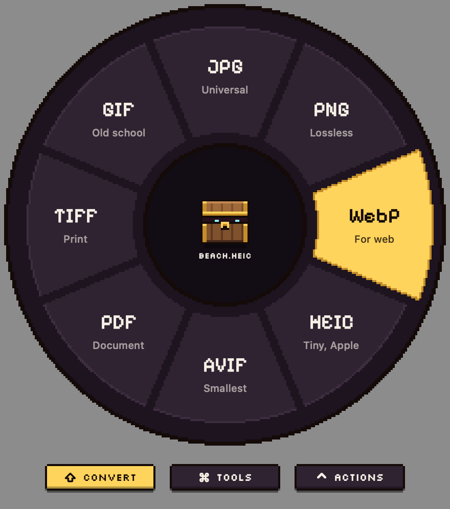
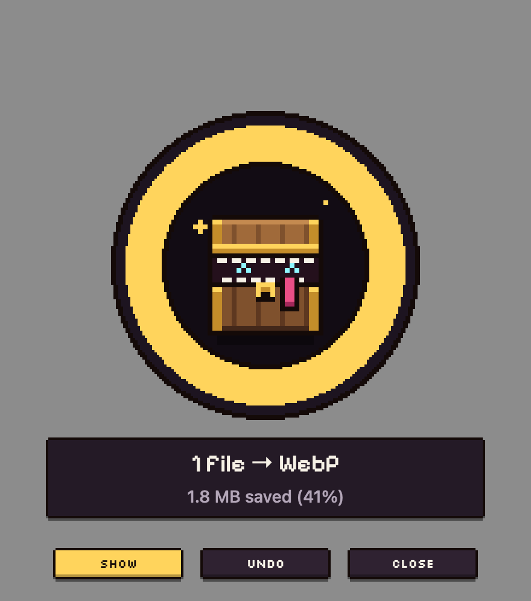

# Chomp

A pixel-art treasure chest that eats your files. Drag a file, tap a key, drop it on the wheel: Chomp converts, shrinks or sends it. Lives in the menu bar on your Mac.

<p>
  
  
</p>

## Install

1. Download **Chomp.zip** from the [latest release](https://github.com/Zeruxth/Chomp/releases/latest) and unzip it.
2. Drag **Chomp.app** into your Applications folder and open it.
3. The first time, macOS will say it can't check Chomp for malware. That's because Chomp is free and isn't paid-signed with Apple. Click **Done**, then open **System Settings → Privacy & Security**, scroll down, and click **Open Anyway** next to Chomp. You only do this once.

Look for the little chest in your menu bar. Works on macOS 13 or newer, on Apple Silicon and Intel Macs.

Everything happens on your Mac. Chomp never uploads your files.

## Use

Start dragging any file or folder, then tap:

- **⇧ Shift**: convert (JPG, PNG, WebP, HEIC, AVIF, PDF, MP4, GIF, MP3, DOCX…)
- **⌘ Command**: tools (compress, fit under 10/25/50 MB, trim and crop video, cut out background, copy the text in a picture, merge PDFs, word count…)
- **⌃ Control**: actions (AirDrop, copy, copy path, zip, Terminal, Desktop)

A wheel opens under the cursor. Drop on a slice and Chomp gets to work, right there in the wheel: it chews, then shows what it made with **Show**, **Undo** and **Close**. Drop in the middle to cancel. While dragging, you can also hover the keys under the wheel to switch modes.

Other ways in: right-click a file and choose Quick Actions → Chomp it (or Open With → Chomp), or drop files on the menu bar panel. Then click a slice, use ←/→ and Return, or press 1–9.

Your originals are never touched. Results go next to the original, to Downloads/Chomp, or to a folder you pick (menu bar panel → Save to). The panel also has chest skins, quality, and a switch for plain text if pixel fonts are hard to read.

**More settings…** in the panel has the rest: the size limit the fit slices aim under, a folder to watch (new files in it get chewed automatically), shrinking big screenshots as you copy them, update checks, and which slices the wheel shows.

Everything works out of the box: ffmpeg comes inside the app for video and audio. Chomp speaks English, Spanish, French, German, Portuguese, Japanese and Chinese, following your Mac's language.

## Windows

Download **Chomp-Windows.zip** from the [latest release](https://github.com/Zeruxth/Chomp/releases/latest), unzip it anywhere and run **Chomp.exe**. The chest lives in the system tray.

- Drag any file, then tap **Shift** (convert), **Ctrl** (tools) or **Alt** (actions): the wheel pops up under your cursor, just like on a Mac.
- Or click the chest and drop files on the panel, or right-click any file → **Send to → Chomp**.
- Everything the Mac does, More settings included, with Windows stand-ins: **Share** opens the Windows share sheet instead of AirDrop, background removal runs a small model on your PC, and documents convert between PDF, DOCX, RTF, TXT, HTML, ODT and Markdown (old binary .doc isn't read).
- ffmpeg and the cut-out model come in the zip.
- HEIC needs Microsoft's free HEIF Image Extensions (and the HEVC Video Extensions, for making HEIC) from the Store.

Windows will warn that Chomp is from an unknown publisher (it isn't paid-signed). Click **More info → Run anyway**.

## Build it yourself

```bash
xcode-select --install     # once, for Apple's command line tools
./fetch-ffmpeg.sh          # optional: puts ffmpeg inside the app (releases do this)
./build.sh --install       # builds Chomp.app and copies it to /Applications
./smoke-test.sh build/Chomp.app   # runs real conversions headlessly
```

`UNIVERSAL=1 ./build.sh` builds one app that runs on both Apple Silicon and Intel.

On Windows, with the [.NET 10 SDK](https://dotnet.microsoft.com/download):

```powershell
dotnet publish windows/Chomp -c Release -o out
windows/fetch-ffmpeg.ps1 out          # optional: video, audio and AVIF
windows/fetch-model.ps1 out           # optional: Cut out (background removal)
windows/smoke-test.ps1 out/Chomp.exe  # runs real conversions headlessly
```

## From the command line

Both apps can run any wheel slice without the UI, which is handy for scripts:

```bash
/Applications/Chomp.app/Contents/MacOS/Chomp --run to.webp photo.jpg
```

```powershell
Chomp.exe --run vid.fit clip.mov
```

The slice ids (`to.jpg`, `img.compress`, `img.text`, `vid.fit`, `pdf.merge`…) are in `Catalog.swift`.

## Releases

Pushing a tag like `v0.3.0` makes GitHub build Chomp.zip and Chomp-Windows.zip and publish them as a release (see `.github/workflows/release.yml`):

```bash
git tag v0.3.0
git push origin v0.3.0
```

## Files

- `DragWatcher.swift`: spots file drags anywhere and catches the key taps. No Accessibility permission needed.
- `Wheel.swift`: the wheel window, hit-testing, layout, and the result disc after a drop.
- `PixelArt.swift`: chest skins, pixel icons, pixel fonts, frames, and the pixel-by-pixel wheel art.
- `Mimic.swift`: Chomp, frame by frame.
- `Catalog.swift`: which options show for which file type.
- `Engine.swift`, `Converters.swift`, `WebP.swift`: the actual work (ImageIO, PDFKit, Vision, textutil, libwebp, ffmpeg).
- `Editor.swift`: the trim and crop window. `Background.swift`: the watched folder, clipboard shrinking and update checks. `SettingsWindow.swift`: More settings.
- `Localization.swift` and `Resources/Localization/strings.json`: translations, shared with the Windows app.
- `HUD.swift`: the bottom toast, used when the wheel has closed. `MenuPanel.swift`: menu bar panel and settings.
- `windows/Chomp/`: the Windows app (C#, WPF). Same catalog, pixel art and wheel, drawn by the same maths; WIC, PDFsharp, PdfPig and Windows' PDF renderer do the work.
- `Snapshot.swift`: `Chomp --snapshot <folder> [--skin slime]` saves PNGs of the UI; `Chomp --run <op> <files>` runs a conversion from Terminal.

## Licence

MIT, see [LICENSE](LICENSE). Includes libwebp (BSD) and the Pixelify Sans and Silkscreen fonts (SIL Open Font License). Release builds bundle ffmpeg (GPL; see `ffmpeg-SOURCE.txt` in the app) and, on Windows, the Silueta background-removal model (Apache 2.0).
